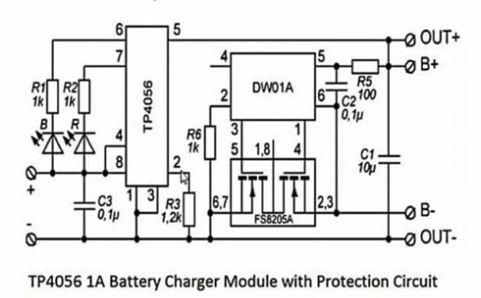
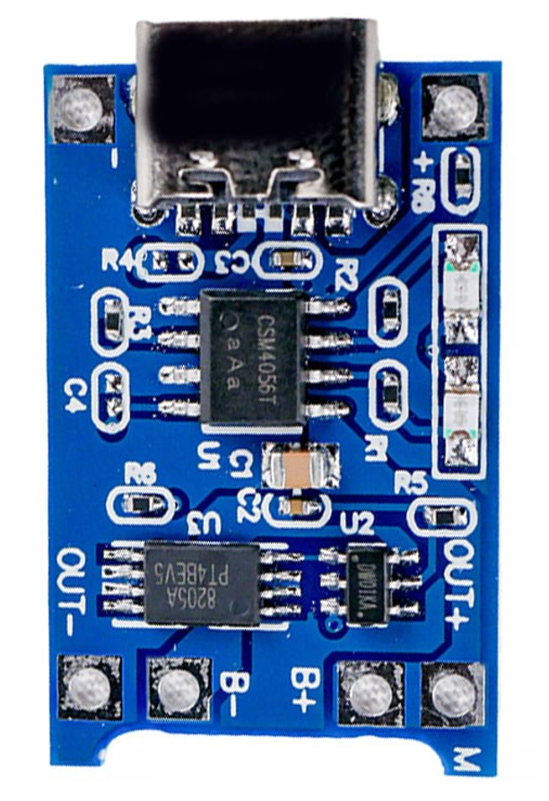
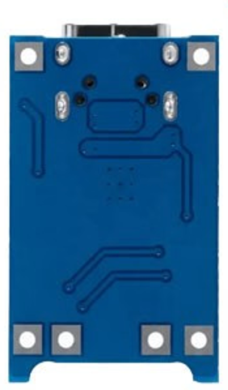

# Cargador de Batería de Litio TP4056 con USB-C y Protección

## 1. Descripción del proyecto

El objetivo de este trabajo práctico es diseñar y desarrollar una placa de circuito impreso (PCB) para un cargador de baterías de ion-litio de una celda (1S), basado en el circuito integrado TP4056, con alimentación mediante un conector USB-C y una corriente de carga de hasta 1 A.

El circuito implementará un sistema de carga en corriente constante y tensión constante (CC/CV), con una tensión final de carga de 4,2 V. Además, incorporará un circuito integrado de protección para resguardar la batería frente a condiciones de sobrecarga, sobredescarga y sobrecorriente, incluyendo cortocircuitos, según las características del circuito de protección seleccionado.

El diseño contempla el desarrollo del esquemático eléctrico, la distribución de los componentes, el diseño de las pistas de cobre y la generación de los archivos necesarios para la fabricación de la PCB.

## 2. Objetivos

- Diseñar una PCB para un cargador de baterías de ion-litio de una celda.
- Implementar la carga mediante el TP4056 con alimentación USB-C.
- Configurar una corriente de carga de hasta 1 A, de acuerdo con las especificaciones del circuito y las condiciones térmicas.
- Incorporar protección electrónica para la batería.
- Diseñar una placa compacta, funcional y adecuada para su fabricación.
- Verificar el funcionamiento del circuito y documentar el diseño.

## 3. Esquemático eléctrico

El esquemático representa las conexiones eléctricas entre el conector USB-C, el circuito integrado TP4056, los componentes auxiliares, la conexión de la batería y el circuito de protección.

## 4. Diseño de la PCB

A continuación, se presentan las vistas superior e inferior de la placa diseñada.

### 4.1. Vista superior

### 4.2. Vista inferior

## 5. Funcionamiento general

El cargador recibe alimentación de 5 V a través del conector USB-C. El TP4056 controla el proceso de carga de la batería de litio mediante un algoritmo de corriente constante y tensión constante (CC/CV), limitando la corriente durante la carga y regulando la tensión final a aproximadamente 4,2 V.

El circuito de protección supervisa las condiciones de funcionamiento de la batería e interviene ante situaciones anormales, según las funciones implementadas por el integrado de protección y sus componentes asociados.

La corriente máxima de carga debe verificarse en función de la resistencia de programación del TP4056, la capacidad de la batería, la disipación térmica del circuito y las características de la PCB.

## 6. Licencia

Este proyecto se distribuye bajo la licencia **CERN Open Hardware Licence Version 2 – Strongly Reciprocal (CERN-OHL-S-2.0)**.

Esta licencia permite estudiar, utilizar, modificar, fabricar y redistribuir el diseño de hardware de acuerdo con sus términos y condiciones. Los diseños derivados distribuidos deben cumplir con las obligaciones de reciprocidad establecidas por la licencia.

El texto completo se encuentra en el archivo [`LICENSE`](../../LICENSE) ubicado en la raíz del repositorio.

Más información: [Open Source Hardware Association (OSHWA) – FAQ](https://www.oshwa.org/faq/).

Texto oficial: [CERN-OHL-S-2.0](https://ohwr.org/cern_ohl_s_v2.txt)

## 7. Referencias

- [TP4056 – Hoja de datos del circuito integrado](https://github.com/maxiespinolaSeeiT/DCI_TP_FINAL_Espinola/blob/main/info/TP4056_eng.pdf)
- [Open Source Hardware Association (OSHWA)](https://www.oshwa.org/)
- [CERN Open Hardware Licence Version 2](https://ohwr.org/cern_ohl_s_v2.txt)
